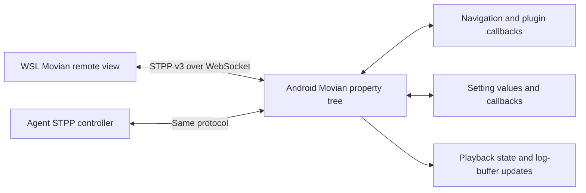

# Movian-to-Movian control: observed STPP and PS5 implementation plan

2026-11-23. DNS/Avanpost troubleshooting is deferred at the user's request.
This investigation used the running WSL Movian and the user-selected Android
TV peer `matv`. No old andoma source was read. The PS5 remains on v59; this
work adds an inspection/controller tool, not a PS5 remote-control server yet.
Sandbox-lift stays excluded.

## What was demonstrated

The installed WSL M7 7.0.273 discovered `matv`, whose HTTP root identifies M7
7.0.289. The selected service has type `movian` and URL
`stpp:id:<instance-id>`. Opening it creates a local page of type `stpp` with
a resolved `stpp://<peer>:<http-port>` remote URL. The desktop then subscribes
to the peer's properties and renders the remote interface using those models.
Commands and property changes travel back over the same connection.

The following operations were performed on the actual Android TV build:

| Observation/test | Result |
| --- | --- |
| Native WSL connection and initial page subscriptions | Captured the HTTP upgrade, STPP handshake and hundreds of subscriptions/notifications |
| Open Settings through STPP OpenURL | Remote navigation URL became `settings:` |
| Browse General settings through exported child references | Read the actual typed rows and values |
| Change Show filename extensions | Integer property changed 1 → 0; an independent HTTP property read also reported 0 |
| Restore the setting | STPP and independent HTTP reads confirmed 0 → 1 |
| Open KinoZal.TV through STPP | Remote URL became `KinoZal.TV:start`, title `KinoZal.TV` |
| Navigate Back | Returned to the preceding page |
| Observe live clock | Existing subscription advanced by two seconds without a polling request |
| Observe logs | Subscribed to 43 log entries; navigation appended another, increasing the collection to 44 |
| Unsubscribe | The selected clock stream stopped delivering notifications |
| Reusable controller | Independently connected, observed clock updates, opened General and returned Back |

The filename-extension preference was restored. Final verification showed WSL
connected directly to the Android peer and Android on KinoZal.TV. No plugin,
credential, permission, update or network setting was changed. Navigation
history naturally reflects the inspection; no claim of restoring its exact
original stack is made.

This establishes remote UI/state/control and live log subscription. Pixel video
mirroring, audible audio, playback/seek control and every setting type were not
verified. Android returned 404 for `/api/screenshot`. A remote UI alone is not
independent evidence of the decoded picture or audible output.



## Evidence and limitations

The WSL executable SHA-256 is
`da133c4a6ee509da8f3b74dd2dfd1b445988381c5b3210d57b15a2e3a96ac9b1`.
The [shipped-artifact report](STPP_ARTIFACT_FINDINGS.md) records REA identity,
the unsupported Windows ELF/Ghidra route, and supplementary GNU disassembly.
Static deductions are not presented as runtime observations. The attached
Android APK was 7.0.288, so its inventory is not treated as the live 7.0.289 code.

REA packet analysis was run inside WSL using a locally scoped, checksum-verified
Node.js 24.11.1 runtime and the existing REA 6.8.0 package. TShark/tcpdump were
installed in WSL for this capture. No REA MCP/client registration was modified.
Captures were limited to the selected peer and protocol ports.

| REA observation | Evidence ID | Scope |
| --- | --- | --- |
| Packet tool identity | `ev_6cd029afc0f7b0c595bac5bfe40862ea07ca2474bef7f85d0e04a9550d319e4d` | TShark and capinfos 4.2.2 identities |
| Native connection capture | `ev_e1dce4dc2c4e1e7a57f69bd7fe4d70a846ed2fd643b47a6eca7a6c865aa6276b` | 646 packets; partial coverage, including an existing stream |
| Controlled action capture | `ev_c3ce5db4623bf60ac9167cb842605e30c93dae9dc7f42591c391b54ff79e50bf` | 487 packets; complete provider coverage |
| WebSocket field inventory | `ev_adcab00257335631b4da24c27af42b014a44d4eb3777c504038fbd3746666f04` | Registered field definitions, not execution evidence |
| WebSocket frames | `ev_13fd9109076db098c10a9177a7772395b5d207e3a9f4f17f7c02d34faa7143d0` | Binary opcode 2 frames in controlled action capture; returned first 8 of 67 matches |
| Discovery capture | `ev_ec21ff9e20fcd28de9f714321429b5b52be3f9a7c277930cfda453ed0a63547b` | 6 packets; complete provider coverage |

Private PCAPs, raw frames, device IDs, endpoint details, the setting-change
checks and final-state verification remain under ignored
`build/remote-control-rea/`. The transparent-proxy stream includes a complete
native HTTP handshake and decoded WebSocket messages; its retained sample has
440 native subscriptions and 509 server property notifications. Packet metadata,
manual STPP decoding, live callback effects and static inference are separate
evidence layers. TShark does not itself assign Movian's custom STPP semantics.

## Discovery and transport

Live capture corroborates an 88-byte custom STPP UDP packet, multicast
destination `239.255.255.250:42000`, and unicast replies. This is a custom
payload; sharing that multicast address does not make it ordinary SSDP XML.

| Byte offset | Field |
| --- | --- |
| 0 | Four bytes `STPP` |
| 4 | Opaque 16-byte instance ID |
| 20 | Protocol version, observed 3 |
| 21 | Flags, observed 3; individual bit meanings are static deductions |
| 22 | Advertised HTTP port, unsigned big-endian 16-bit |
| 24 | 32-byte name field |
| 56 | Second 32-byte text field |

The Android sender used an ephemeral UDP source port for multicast; responders
used source port 42000 for unicast replies. The WSL advertisement carried its
actual HTTP port, which was 44456 during this investigation. Do not hardcode
42000 as every peer's TCP port or confuse it with the UDP discovery port.

The resolved TCP connection upgrades at `/api/stpp`. The native WSL client sends:

```http
GET /api/stpp HTTP/1.1
Connection: Upgrade
Upgrade: websocket
Sec-WebSocket-Key: 1

```

Its legacy request omits Host and Sec-WebSocket-Version. A server that accepts
only a strict modern WebSocket handshake will reject this real client. Modern
websocket-client 1.8.0 was also accepted by Android during the controlled tests.

WebSocket binary payload `00 03 00` starts STPP v3. The server replies
`00 03 <16-byte instance ID> 00`. Native clients reject their own instance ID.
Ping/pong frames were also observed; keep them separate from STPP commands.

## Property model and commands

Property addressing uses a little-endian 32-bit base reference and a list of
UTF-8 name components, each prefixed by its byte length. Root reference 0 is
the exposed global tree. An address embedded before a value/event terminates
its path with zero. Native standalone subscribe paths run to frame end.

Subscription IDs and exported child-property IDs are separate. Child references
are scoped to a connection; reconnect invalidates them. The desktop subscribes
to roots including `app/systemname`, `navigators/current/pages`, `popups`,
`services/stable`, `media/current` and `notifications/nodes`, then follows
exported references into page models, metadata, values and options.

| Client command | Observed/recovered encoding |
| --- | --- |
| 0 | Version handshake |
| 1 | Subscribe: subscription ID, base reference, 16-bit flags, name path |
| 2 | Unsubscribe: subscription ID |
| 3 | Write: property address, typed value; integer writes were verified live |
| 5 | Event: property address, event type and payload |

Server property notifications begin with opcode 4, subtype and subscription ID.
Scalars, directory creation, child vectors, removal/movement and selection use
different subtypes. The artifact report gives exact layouts and marks unresolved
subtypes. Subscription flags 0 and 8 were observed in the native stream; flag
names must not be inferred solely from those values.

The tested OpenURL event is type 14, optional-field mask 1, and a length-prefixed
URL string, sent to `navigators/current/eventSink`. The tested Back action uses
event type 1 and an action-name string. Integer setting writes target the
exported row's `value` property; the actual setting callback updates and persists
the preference. This is why control should call the shared backend, rather than
maintain a separate remote-only copy of settings.

The log buffer is a directory of unnamed entry properties with `prefix`,
`message` and `severity`. Collection additions can be subscribed to live. This
is the structure to adapt from the PS5 diagnostics ring, alongside player/torrent
statistics; it does not require repeated FTP snapshots.

## Reusable controller added

`scripts/movian_stpp.py` provides typed wire encoding, bounded notification
decoding, subscriptions, child collections, OpenURL, actions and integer writes.
Its CLI defaults to read-only observation and prints incoming events as JSON
lines. Mutations require explicit arguments. Exported references should be used
through the persistent Python Client instance, not copied between sessions.

Network use needs optional `websocket-client==1.8.0`. Codec tests are standard
Python and are included in `scripts/self-check.sh`:

```sh
python3 tests/stpp_protocol.py
```

An isolated environment and read-only watch can be prepared with:

```sh
python3 -m venv build/stpp-client-venv
build/stpp-client-venv/bin/pip install websocket-client==1.8.0
build/stpp-client-venv/bin/python scripts/movian_stpp.py \
  --url ws://TV_IP:HTTP_PORT/api/stpp \
  --path '["clock","unixtime"]' --seconds 5
```

Replace the placeholders with the selected peer's advertised endpoint. Six wire
tests passed against native subscribe/notification shapes, typed write and event
vectors, long UTF-8 strings and malformed input. The reusable Client additionally
passed live subscription/unsubscription and navigation/Back tests against matv.
No new PS5 package was built for this host-tool-only change.

## Three-part PS5 build plan

### 1. Compatible server and shared property graph

Implement the v3 codec/server with stable per-connection references, subscriptions,
collection changes, OpenURL/actions and typed writes. Begin in host preview with
`app/systemname`, one Home page, one settings page and a log buffer. Accept the
captured legacy native handshake as well as a modern client. Ignore unsupported
operations safely and expose unavailable actions honestly.

Use the real UI/settings callbacks through a bounded UI-thread command queue.
Publish graph changes from the same state used by the local UI. Keep worker,
decoder and settings ownership explicit so network threads cannot mutate UI
globals or reuse freed exported nodes.

**Host acceptance passed in v60:** the unmodified WSL M7 viewer rendered the
actual shared Home/Settings adapter, changed/restored filename extensions, and
the saved settings and pushed updates agreed. Socket and native evidence are
recorded in [v60](STPP_V60.md) and [native acceptance](STPP_V60_NATIVE.md).
The next unfinished acceptance is the final native PS5 transport/runtime test.

### 2. Safe PS5 transport and complete navigation/settings adapter

Test listener binding through the public SDK without privilege changes. v59's
diagnostics bind is denied with error 13, so direct hosting cannot be assumed.
If that restriction remains, add an opt-in PS5 outbound connection to a paired
PC bridge. WSL connects to the bridge, which carries the same STPP byte stream;
the PS5 still implements server semantics. The control endpoint starts on
loopback, and the console backhaul is limited to its configured peer. This is
a transport proposal pending tests, not an observed desktop mechanism.

Expose real Home/services, page stack, file/network browsers, plugins, all
settings/value types and async dialogs. Reuse the existing SMB/FTP/plugin/torrent
handlers. The latest user request explicitly selects a fresh backed-up test profile,
superseding plugin preservation for this experiment. Add compatible
discovery only after transport works, advertising the reachable endpoint.

**Acceptance:** WSL selects the PS5 endpoint, opens Plugins and a network folder,
changes/restores a setting, and the PS5 and independent controller agree, with
sandbox-lift absent and no physical controller input after initial launch.

### 3. Playback, resources, live diagnostics and recovery

Expose playback controls, seek position, track selection, torrent/cache/peer
state, notifications and live log entries. Add monotonic log/event sequence
numbers and explicit gaps/recovery so reconnects cannot silently masquerade as
complete history. Implement the required image/resource operations for artwork.
Integrate the controller with the agent through the existing CLI or a persistent
tool wrapper; MCP registration is not necessary to prove the protocol.

Provide a separately tested framebuffer capture path for pixel inspection;
audio verification is another capability. Test cancellation, reconnects, stalled
clients, bounded queues, stale references and playback continuity.

**Acceptance:** an automated session browses a source, starts known media,
seeks/switches tracks and videos, inspects live decoder/torrent/log state and
recovers its subscriptions after disconnect, without manual Cross presses.
Launching a closed/crashed title requires a separate supported launcher path:
STPP belongs to the running app and does not itself start the PS5 title.

## Current boundary

The mechanism is demonstrated on the actual WSL/Android pair; v60 adds the
server and shared adapter with native WSL host acceptance. The latest user
authorizes a default-off per-console access experiment instead of the earlier
no-lift transport-only proposal. PS5 runtime acceptance, artwork RPC, complete
setting-type coverage and autonomous relaunch remain separate checks.
See [v60 results and current boundary](STPP_V60.md).
