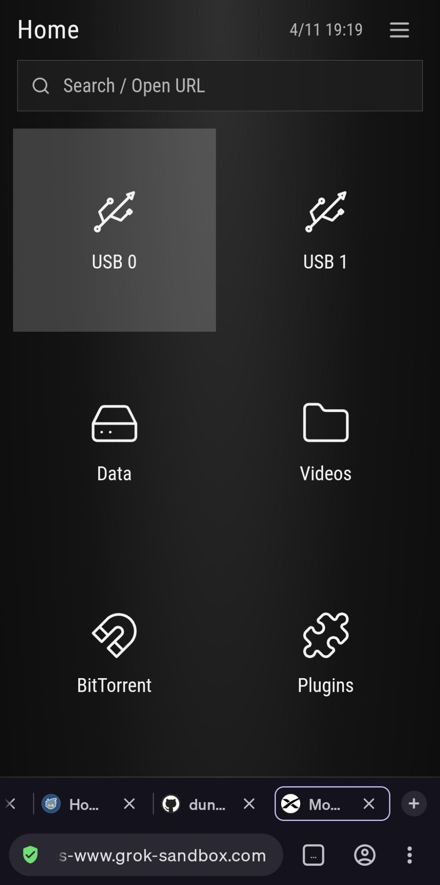
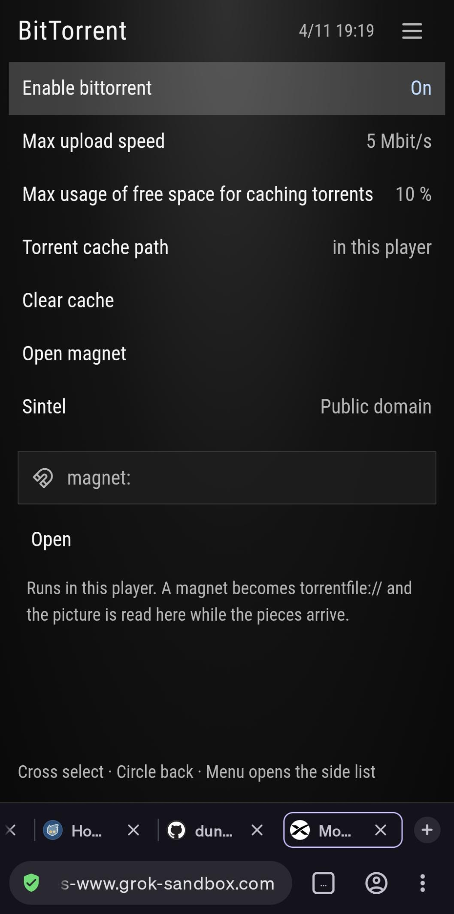
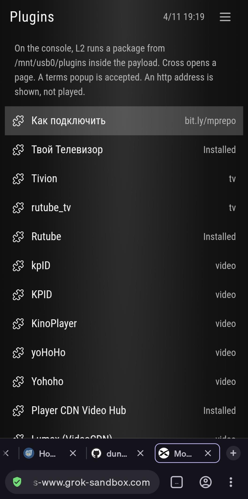

# Using Movian

Four places, the same ones as the preview: Home, Videos, BitTorrent, Plugins.

On the television the list is on the left and the page is on the right. The font is the console font, not this phone layout.

## Pad

| Button | Home | A list or BitTorrent | Playback |
| --- | --- | --- | --- |
| Up / Down | Move. On Home this also moves USB 0, USB 1, Data, then Videos, BitTorrent, Plugins | Move the row | Previous / next file |
| Cross | Open the highlighted row | Play, or start the torrent row | Pause |
| Circle | | Back | Back |
| Left / Right | | | Seek. The step is in Options |
| L1 | Scan again | Scan again | Previous file |
| Options | Settings. Tap again to close | Settings | Settings |
| Hold Options | Quit | Quit | Quit |
| L2 | Packages already on disk | Packages already on disk | Packages already on disk |

## Home

USB 0, USB 1 and Data, each with a count. Cross opens that device's files. The line at the bottom is the scan result. Read it when a folder looks empty: [USB and files](usb.md).

## Videos

Every video the scan kept, from every device. Cross plays the highlighted file.

## BitTorrent

Two rows: Sintel, and torrent files found on USB or in data. Cross on Sintel starts the built-in client. Cross on torrent files opens the `.torrent` list.

This is not the browser's WebTorrent engine. The console client uses HTTP and UDP trackers and plaintext peers. It has no DHT. Sintel plays only when a peer answers. A swarm that only answers encrypted peers will not connect.

## Plugins

Cross opens the catalog. With no settings file yet, the address is `https://bit.ly/mprepo`. An empty saved address is the official repository. On the repository row, Right moves to the next address. Full steps, in Russian and English: [Plugins](plugins.md).

L2 is separate. It lists packages already stored under `plugins/` on USB, `/data/movian/plugins`, or `/download0/movian/plugins`.

## Settings

Options opens the same settings pages as M7's General page: the repository address, beta passwords, automatic upgrade, install on demand, Browse, and Upgrade. Strings use the pad keyboard. Triangle shifts letters. Square or L1 erases. R1 or done saves. Circle cancels.

Playback speed on that menu is 0.5x, 1x, 1.5x, or 2x. Repository, then Playback, also stores 0.75x and 1.25x, and the seek step.
