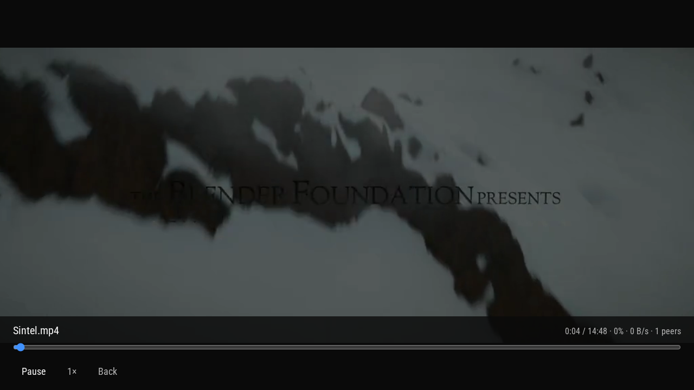

# Playback



The picture above is the browser preview playing Sintel from a torrent. The console player is the same idea: the file plays in Movian while the pieces arrive. The console client is not the browser's WebTorrent engine.

## Files the home-screen title opens

| | |
| --- | --- |
| Picture | MPEG-1, H.264, HEVC, MPEG-4, MPEG-2, MJPEG, WMV, VC-1, VP8 |
| Sound | AAC, AC-3, E-AC-3, MP3, DTS, TrueHD, Opus, FLAC, PCM. Mixed to stereo |
| Container | MP4, MKV, MPEG-TS, AVI, WMV, ASF, FLV, MPEG, VOB, WebM when the picture codec above is inside |

Names it looks for: `.mpg` `.mpeg` `.mpv` `.m1v` `.m2v` `.mp4` `.m4v` `.mov` `.mkv` `.ts` `.m2ts` `.mts` `.avi` `.webm` `.wmv` `.asf` `.flv` `.vob`, plus `.torrent`.

Pictures above 1080p are scaled down in software. Hardware decode is libSceVideodec2 for H.264 and HEVC when that module loads. The first toast says whether the hardware path or the software path opened. 10-bit H.264 stays on software. Atmos and DTS:X objects are not rendered past the channel bed.

VP9, AV1, and encrypted files do not open. bzip2-compressed Matroska tracks do not open.

## When a file will not play

The list stays open and the line says why:

| Line | Meaning |
| --- | --- |
| `cannot open` | The path could not be opened |
| `cannot read file` | The container header could not be read |
| `no supported video` | No picture stream had a decoder |
| `no decoder` | The picture codec is not in this build |
| `decoder refused` | The decoder rejected the stream |
| `picture too small` | Below 16 pixels on a side |
| `picture format` | The decoded picture was not a format this player can draw |
| `cannot play` | The file opened and no picture came out |
| `unreadable` | Something else failed before a reason was stored |

An empty folder is not a codec problem. Read the scan line in [USB and files](usb.md).

## BitTorrent

BitTorrent on the home screen starts Sintel, or a `.torrent` file from USB or data. Trackers are HTTP and UDP. Peers are plaintext. There is no DHT. HTTPS trackers are skipped.

The piece cache is `/data/splicer/bt`, or `splicer-bt` on USB when `/data` is not writable.

A magnet in `/mnt/usb0/splicer.txt` is also picked up:

```text
a=magnet:?xt=urn:btih:...
```

## Seek and speed

Left and Right seek during playback. Cross pauses. Up and Down, or L1 and R1, change file.

Options sets 0.5x, 1x, 1.5x, or 2x. Repository → Playback also stores 0.75x and 1.25x, and the seek step (5, 10, 30, or 60 seconds).
