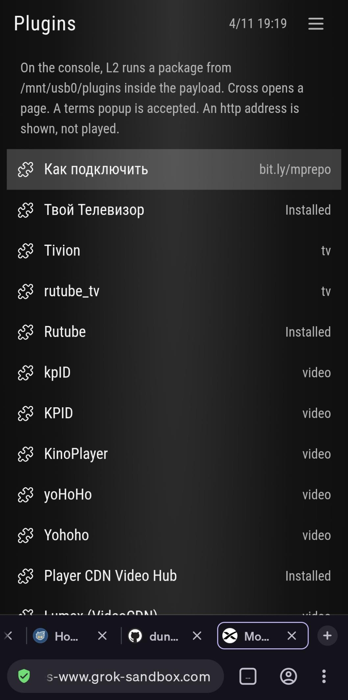

# Плагины



Адрес репозитория:

```text
https://bit.ly/mprepo
```

Тот же файл: [plugins/repo.json](../plugins/repo.json).

Для использования данного альтернативного репозитория плагинов прописать в настройках Movian адрес выше.

Путь: **Settings → General → Alternative plugin repository URL**
(Настройки → Общие → Alternative plugin repository URL).

Вернуться на домашний экран. Плагины появятся в **Plugins → Browse available plugins**.

P.S.
Если вдруг в альтернативном репозитории категории остаются пустыми или плагины в них исчезли, либо при установке плагинов выдает ошибку, то пробуем использовать сервисы VPN.

Чтобы вернуться к официальному репозиторию, прописанный в настройках Movian адрес альтернативного репозитория полностью удаляем, оставив поле пустым.

На домашнем экране PS5 тот же каталог открывает строка Plugins. Без файла настроек адрес уже `https://bit.ly/mprepo`. Пустое сохранённое поле — официальный репозиторий. Вправо на строке репозитория переключает готовые адреса. Консоль не ходит по редиректам bit.ly. Если этот адрес не открывается, следующий в том же переключении — прямой файл на GitHub.

## English

Enter this address in Movian:

```text
https://bit.ly/mprepo
```

**Settings → General → Alternative plugin repository URL**

Go back to the home screen. Plugins are listed under **Plugins → Browse available plugins**.

If categories stay empty, plugins disappear, or install fails, try a VPN.

To use the official repository again, delete the address and leave the field empty.

## On this PS5 title

Plugins on the home screen opens that catalog. With no settings file yet, the address is already `https://bit.ly/mprepo`. A saved empty address is the official repository `https://repo.movian.eu/plugins-v1.json`.

Right on the repository row cycles four values: empty (official), `https://bit.ly/mprepo`, the raw file on GitHub, and the official URL written out. The console HTTP client does not follow redirects. If the bit.ly preset fails to load, use the raw GitHub URL in that same cycle.

- Cross on a string opens the pad keyboard. Triangle shifts letters. Square or L1 erases. R1 or done saves. Circle cancels.
- **Browse available plugins** downloads the feed and installs the package you pick into a directory L2 already scans (`/data/movian/plugins`, `/mnt/usb0/plugins`, `/mnt/usb1/plugins`, `/user/movian/plugins`).
- **Automatically upgrade plugins**, when on, upgrades an installed package after that fetch if the feed's version is newer. **Upgrade installed plugins** does that even when the switch is off.
- **Auto install plugins on demand** installs a missing package when a page URL matches a `control.uriprefixes` entry from a feed that has already been fetched. This repository's `plugins/repo.json` does not publish those prefixes.
- Beta passwords are sent as repeated `betapassword` query arguments, the same as M7.
- Hold Options quits.

The loader ELF uses the same pages under Options → Repository. See [Loader ELF](payload.md).
